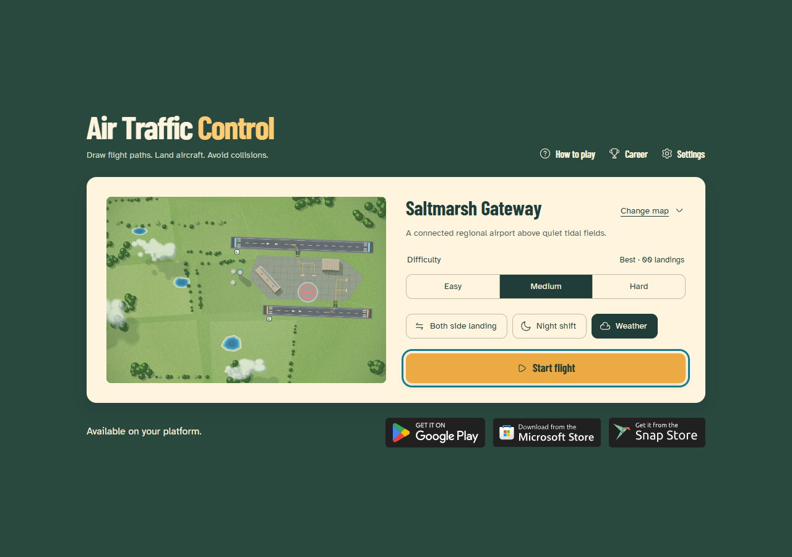

# Air Traffic Control

> Draw flight paths. Land aircraft. Avoid collisions.

[](https://github.com/montasim/air-traffic-control/actions/workflows/ci.yml)
[](LICENSE)
[](https://www.supportkori.com/montasim)

Air Traffic Control is a browser arcade game for short, increasingly busy air-traffic shifts. Guide three aircraft types to matching runways and helipads across twelve airfields, unlock new locations through a local career, and collect achievements. It plays with a mouse, touch, or pen, on desktop and phone screens, upright or on their side.

**[Play in your browser](https://airtrafficcontrol.netlify.app/) · [How to play](#how-to-play) · [Run locally](#run-locally) · [Report a bug](https://github.com/montasim/air-traffic-control/issues)**

### Get the app

<a href="https://play.google.com/store/apps/details?id=dev.montasim.airtrafficcontrol"></a>
<a href="https://apps.microsoft.com/detail/9N5536ZQ2XZM"></a>
<a href="https://snapcraft.io/air-traffic-control"></a>

Android: [Google Play](https://play.google.com/store/apps/details?id=dev.montasim.airtrafficcontrol). Windows: [Microsoft Store](https://apps.microsoft.com/detail/9N5536ZQ2XZM). Linux: [Snap Store](https://snapcraft.io/air-traffic-control). Check each listing for device requirements and the available release. Store versions can lag behind the browser version and the latest source.

[](https://airtrafficcontrol.netlify.app/)

*Start screen for a new player, captured from the current source.*

## What you can do

- Draw and revise routes with a mouse, touch, or pen across twelve airfields.
- Match airliners, commuters, and helicopters to their landing destinations.
- Hold an aircraft in a circle while the way clears, and switch between normal, one and a half, double, and half speed.
- Choose Easy, Medium, or Hard, and optionally allow landings at either end of a runway.
- Fly a night shift with runway and aircraft lights, with or without drifting clouds.
- Learn in a practice flight with no timer or effect on your career.
- Unlock airfields through nine career ranks, earn nine achievements, and pick a fleet livery.
- Pause and pick up an unfinished shift later, keep progress on your device, and play offline once the browser app is cached.

## How to play

[Open Air Traffic Control](https://airtrafficcontrol.netlify.app/) in your browser, or launch an installed copy.

Choose an airfield and **Easy**, **Medium**, or **Hard**, then select **Start flight**. The **How to play** page includes a practice flight with a landing lesson and a holding lesson.

1. Press an aircraft with your mouse, finger, or pen and hold.
2. Draw a route to the destination with its matching color and letter, ending on the highlighted landing area. Release when it lights up; the aircraft lands when it reaches its target.
3. Keep aircraft apart. Red rings joined by a line warn that two aircraft are too close. Draw a new route to reroute one, or hold it.

| Aircraft | Destination |
| --- | --- |
| Cyan airliner | Runway marked **L** |
| Amber commuter | Runway marked **C** |
| Coral helicopter | Helipad marked **H** |

Each safe landing earns one point. A collision or an aircraft leaving the sector ends the shift.

### Controls and options

| Control | What it does |
| --- | --- |
| **Hold** | Tap an aircraft to make it circle where it is: 5 loops on Easy, 3 on Medium, 2 on Hard. Its ring fades as the loops run out, then it flies on the way it was heading. Only two aircraft can hold at once. |
| **Speed** | The bottom-left button steps through normal (1×), one and a half (1½×), double (2×), and half (½×) speed. |
| **Pause** | Use the on-screen control or **Escape**. |
| **Both side landing** | Lets aircraft land at either end of a runway instead of only the highlighted end. Choose it before a flight; it stays fixed during a shift. |
| **Night shift** | A darker map with runway lights, aircraft headlights, and red tail beacons. Same rules and records as day. |
| **Weather** | Clouds drift over the map. They pass under aircraft and routes and thin out over the airfield, so play is unchanged. |
| **Resume shift** | A shift is saved whenever it pauses, even if you leave the app; pick it up from the Play screen. |

Night shift and Weather are chips on the Play screen. Difficulty can be changed on the Play screen or on **Choose airfield**. Any aircraft that reaches its matching runway end lands, even if another aircraft is landing on the same runway.

Resizing the window keeps the shift and pauses it when needed; select **Resume** once the field is large enough to play. A shift keeps the screen orientation it started in, so turning a phone during a shift may require a new shift for a full-size field.

## Airfields and progression

Each airfield has its own landscape and runway layout but shares the same routing rules. New players start with Saltmarsh Gateway and River Bend; career promotions open the rest.

| Airfield | Setting | Unlocks at |
| --- | --- | --- |
| Saltmarsh Gateway | Regional airport above tidal fields | Start |
| River Bend | Compact airfield beside a curved river | Start |
| Desert Parallel | Offset approaches across a mineral basin | Control Assistant |
| Executive Point | Business aviation on a coastal headland | Control Assistant |
| Twin Banks | Two fields sharing a river corridor | Tower Controller |
| Metro International | Long parallel approaches around a passenger concourse | Tower Controller |
| Falcon Air Base | Military aprons with separate fixed-wing and rotor approaches | Approach Controller |
| Freight Junction | Warehouse aprons and offset runways in an industrial basin | Area Controller |
| Island Rescue | A coastal airstrip and two island rescue pads | Senior Controller |
| Frost Crossing | A snowbound island field with parallel runways either side of its apron | Chief Controller |
| Carrier Coast | Liners land at a shore airfield; commuters land on a carrier offshore | Flight Director |
| Blue Water | Open ocean and one carrier deck that takes every arrival; no liners | Air Boss |

On Carrier Coast and Blue Water, the fleet is drawn as military aircraft (a transport, a fighter, and a gunship) with the same destinations and behavior as their civil counterparts. Carrier decks are landed from the stern only, in both runway-end modes. Island Rescue, Carrier Coast, and Blue Water each have two helipads.

Difficulty changes aircraft arrival frequency, speed, traffic limits, and how many loops a hold lasts. Best scores are tracked separately for each airfield, difficulty, and screen orientation, and are shared across both runway-end settings.

The nine career ranks run from Control Trainee to Air Boss. Ranks and nine achievements reward safe landings, mixed aircraft handling, exploring airfields, and demanding shifts. Progress is recorded when a shift finishes. Restarting or abandoning an unfinished shift discards that shift's progress; practice flights do not affect records or achievements.

### Aircraft liveries

Choose a fleet livery in **Your career → Aircraft liveries**. Classic is available from the start; Signal unlocks at Tower Controller, and Midnight at Senior Controller. Unlocks never equip automatically. Your choice is saved on this device and applies on your next flight. Liveries preserve aircraft shapes, destination colors, speed, and collision behavior.

## Run locally

Use **Node.js 24** (`.nvmrc`, `engines`, and CI) and **npm 11.13.0** (the declared package manager). The repository uses npm and `package-lock.json`.

```bash
git clone https://github.com/montasim/air-traffic-control.git
cd air-traffic-control
npm ci
npm run dev
```

Open the local URL printed by Vite, normally [http://localhost:5173](http://localhost:5173), choose an airfield, and start a flight. The development server listens on all interfaces, so a phone on the same network can open the network URL Vite prints.

| Command | Purpose |
| --- | --- |
| `npm run dev` | Start the Vite development server |
| `npm test` | Run the Vitest suite once |
| `npm run test:watch` | Watch tests during development |
| `npm run typecheck` | Check TypeScript |
| `npm run build` | Type-check and build production assets into `dist/` |
| `npm run preview` | Serve the production build locally |

## Saves, sound, and offline use

Career progress, achievements, records, the selected airfield and difficulty, and settings (runway-end mode, Night shift, Weather, livery, and audio) are stored locally in IndexedDB. A paused, unfinished shift is kept in `localStorage` so it survives the app closing. There is no account system or cloud synchronization. Clearing site data erases progress; save export and import are not implemented. Development and production sites have separate browser storage.

Sound and effects volume are adjustable in Settings. Browsers may require a player interaction before audio starts.

The production build includes a service worker that caches game assets. A first online visit is required; after caching, the game can be reopened offline. Installation and offline behavior depend on browser support. Use HTTPS in production. The development server does not represent the production offline experience.

Store links and the **Support** link in Settings open third-party websites in a new tab (or the system browser in Electron). The Android app hides them. Those pages require an internet connection and handle their own account or payment information; the game does not embed a payment form.

## Status and limitations

The project is in its **0.x release series**. It is an arcade game, not an operational air-traffic-control simulator.

Menus support keyboard navigation, but drawing flight paths requires a pointer. An automated test checks every airfield at desktop, laptop, tablet, and phone sizes (including iPhone SE), upright and on its side, with both runway-end settings: landing areas stay on screen and clear of the on-screen panels, and an aircraft sent to each one lands. Layouts have been checked in Chromium-based browsers; real-device Safari, native touch feel, and long-session difficulty balance still need broader playtesting. See the [end-to-end QA report](docs/end-to-end-qa-report.md) for recorded verification scope.

## Build and deploy

```bash
npm ci
npm test
npm run build
npm run preview
```

[`netlify.toml`](netlify.toml) configures Netlify: it builds with `npm run build` on Node 24, publishes `dist/`, serves `/sw.js` and `/index.html` without caching, and maps `/privacy` to the privacy policy. From a folder linked to the Netlify site, `netlify deploy --prod` builds and publishes to production. The app uses hash routes such as `/#help`, `/#career`, and `/#settings`, so it needs no history-route fallback. Asset paths assume the root of a domain, not a GitHub Pages repository subdirectory.

The [CI workflow](.github/workflows/ci.yml) runs the tests and production build on pushes to `main` and pull requests. CI validation does not deploy the game. The [Linux desktop workflow](.github/workflows/linux-desktop.yml) builds and smoke-tests an AppImage on manual dispatch or a `v*` tag, then uploads a workflow artifact; it does not publish to any store.

For browser regression checks, start `npm run dev -- --port 4287` in one terminal. In another, run `npm run test:resize`, `npm run test:resize:maps`, or `npm run test:runway-ends`. Use `RESIZE_TEST_URL=http://localhost:4287/ npm run test:runway-mode` for the runway-option checks. `npm run test:mobile-boot` boots an emulated iPhone on three airfields and fails if canvas and texture memory passes its budget at startup or when the airfield list opens; set `MOBILE_TEST_URL` to point it at another server. These scripts use Playwright: provide Chrome through `CHROME_PATH`, use `/usr/bin/google-chrome`, or install its bundled browser with `npx playwright install chromium`. Desktop smoke-test prerequisites are in the [Linux release guide](docs/linux-release.md#verify).

## Native and desktop builds

### Android (Google Play)

Install [Air Traffic Control from Google Play](https://play.google.com/store/apps/details?id=dev.montasim.airtrafficcontrol).

The Android app wraps the same game in Capacitor (`android/`). Run `npm run android:sync` to build and copy the game into the Android project, `npm run android:open` to open it in Android Studio, and `npm run package:android` for a signed Play bundle. Gradle needs JDK 21. See [Android release](docs/android-release.md) for signing, icons, verification, and Play Console setup.

### Linux desktop

The Electron version bundles the game for offline play on Linux x86-64, with local saves separate from the browser version. Install the published release from the Snap Store:

```bash
sudo snap install air-traffic-control
```

```bash
npm run desktop       # Build and run Electron
npm run package:linux # Build an AppImage in release/
npm run package:snap  # Build a strictly confined core24 Snap (requires Snapcraft + LXD)
```

See [Linux builds and Snap Store publishing](docs/linux-release.md) for prerequisites, verification, installation, and publishing commands.

### Microsoft Store (Windows)

Build the Windows x64 MSIX for **Sky Routes: Air Traffic Control** locally with `npm run package:msix`; the registered Partner Center identity is configured. There is no Windows CI workflow. See [Microsoft Store release](docs/microsoft-store.md) for the exact commands, local test packaging, and submission checklist.

## Project structure

| Path | Responsibility |
| --- | --- |
| `src/core/` | Framework-independent traffic simulation, holding, and geometry |
| `src/game/` | Three.js rendering, pointer input, airfield layouts, and scenery |
| `src/progression/` | Career ranks, achievements, and liveries |
| `src/storage/` | IndexedDB saves, migrations, and the saved unfinished shift |
| `src/audio/` | Game audio |
| `src/ui/` | DOM menus, map previews, practice flight, and utility pages |
| `src/platform/` | Android-only native integration (back button, outbound links) |
| `electron/`, `desktop/` | Electron desktop shell and its packaging assets |
| `android/` | Capacitor Android project |
| `scripts/` | Packaging, icon generation, and browser regression scripts |
| `tests/` | Simulation, map, device-size, progression, storage, audio, and UI tests |
| `public/` | Bundled fonts, graphics, and public assets |

The DOM menus configure a shift; Three.js translates pointer input into routes for the simulation. Simulation events drive aircraft rendering, sound, and landing feedback. Completed shifts feed progression and local save storage.

Built with TypeScript, Three.js, Vite, Vitest, and Hugeicons; Electron supplies the desktop shell and Capacitor the Android shell. [DESIGN.md](DESIGN.md) describes the visual direction. Historical plans in `docs/` describe development decisions, not promises of future features. Some storage identifiers retain the former name, Vector Approach, to preserve existing saves.

## Documentation

- [Contribution guide](CONTRIBUTING.md): setup, required checks, and save compatibility.
- [Linux builds and releases](docs/linux-release.md): packaging, installation, verification, and Snap publishing.
- [Android release](docs/android-release.md): Capacitor build, signing, and Google Play publishing.
- [Microsoft Store release](docs/microsoft-store.md): MSIX packaging and submission.
- [End-to-end QA report](docs/end-to-end-qa-report.md): recorded browser checks and remaining coverage gaps.
- [Mobile verification](docs/mobile-verification.md): device-layout verification notes.
- [Visual design](DESIGN.md): interface conventions.

## Contributing and support

Read [CONTRIBUTING.md](CONTRIBUTING.md) before opening a pull request. Report reproducible bugs or suggestions through [GitHub issues](https://github.com/montasim/air-traffic-control/issues), including browser or device, airfield, difficulty, and steps to reproduce. Do not post private information or exploitable security details in a public issue.

The repository does not currently publish a dedicated security policy or private disclosure contact, and it has no separate code of conduct; keep contributions respectful and focused.

## Support the project

Optional financial support is available through [SupportKori](https://www.supportkori.com/montasim). You can also help by reporting reproducible bugs, testing on real devices, improving documentation, or contributing code.

## Author

Built and maintained by [Montasim](https://github.com/montasim).

## License

The project is available under the [MIT license](LICENSE). Bundled fonts retain their own notices in [public/fonts/licenses](public/fonts/licenses); dependencies retain their respective licenses. Store badges and logos have separate attribution and terms documented in [public/assets/stores/README.md](public/assets/stores/README.md).

All 12 maps use Three.js with the original map painters and aircraft artwork. Static artwork is rasterized once; the original cloud, water, and aircraft animations remain live. The experimental Blender atlases are retained in art/blender but are not used by the game.

The gameplay HUD shows a compact score and performance stats. Use Settings ? Performance to show or hide the stats; the choice is saved on this device. Run `npm run test:routes` against the development server to check mouse/touch routes, runway labels, selection rings, and confirmation feedback on every map.
